# Contest PPT Studio

[中文](README.md) · [Skill entry](SKILL.md) · [Validation](docs/VALIDATION.md) · [v0.1.0 notes](docs/RELEASE_NOTES_v0.1.0.md)

**Turn contest rules and project materials into a clear brief, visual directions, and a presentation designed for native editing.**

An agent skill for student competitions, including undergraduate innovation projects, career planning, and Challenge Cup. It reviews materials, drafts evidence-aware supplementation prompts, previews visual directions, and coordinates available presentation and image tools.

**v0.1.0 is an initial release.** This repository provides workflow instructions and a read-only structural inspector. Full production requires compatible tools in the host environment. Real-project end-to-end production and PowerPoint/WPS playback have not yet been validated.

## Workflow

```mermaid
flowchart LR
    A[Read rules and project materials] --> B[Identify gaps and draft prompts]
    B --> C[Preview visual directions]
    C --> D[User selects a direction]
    D --> E[Complete key evidence and confirm brief]
    E --> F[Build native objects and animations]
    F --> G[Inspect structure, visuals and playback]
    G --> H[Deliver a reproducible project package]
```



Visual exploration may precede complete content, with assumptions labeled. Official restrictions and protected template elements take priority.

## Design contract

| Area | Default behavior |
|---|---|
| Content | Restructure the narrative around the actual contest, track, stage, and judging criteria; preserve factual meaning |
| Missing material | Explain gaps and required evidence; provide reusable prompts without inventing results |
| No chosen style | Three image boards, each showing a cover, a representative content slide, and a closing slide |
| Chosen style | One three-slide image board in the specified style |
| Fixed official template | Preserve locked content; use one compliant fill preview when the visual system is fixed |
| Titles | Prefer independently selectable vector outlines for each headline character |
| Editable content | Prefer native text, charts, tables, diagrams, decoration, and effects |
| Cover imagery | Collect 5–10 candidates, select a suitable subset, and build depth through masks, cutouts, softness, and coordinated glow |
| Motion | Plan object-specific entrance order, triggers, duration, and delay |
| Handoff | Include PPTX, previews, sources, assets, data, brief, provenance, animation settings, and QA records |

Outlined characters support shape and color editing. Replacing the wording requires rebuilding outlines from the retained source text; this differs from editing a text box.

## Install and invoke

Download and extract the repository. Place the complete `contest-ppt-studio` folder, containing `SKILL.md`, in the skill directory used by your host. Preserve its internal paths.

The current [official Codex documentation](https://learn.chatgpt.com/docs/build-skills) lists user-scoped `~/.agents/skills/` and repository-scoped `.agents/skills/` locations. Follow the actual host configuration for custom or older setups, and preserve any existing skill with the same name.

Example Codex prompt:

```text
Use $contest-ppt-studio with the attached contest rules, project plan, and constraints.
Review evidence gaps and draft supplementation prompts, then show visual boards.
After I select a direction and confirm the brief, create an editable presentation.
```

Provide the current project plan, contest track, template restrictions, time/page limits, and references. The workflow confirms PowerPoint or WPS for each project. The skill body is primarily Chinese; other hosts and languages require tool and workflow adaptation and have not been fully tested.

## Requirements

The host must supply the capabilities needed by the task: document reading, image generation or rendering, native PPTX construction, final-file rendering, and target-application testing. Candidate integrations include [PPT Master](https://github.com/hugohe3/ppt-master) and [huashu-design](https://github.com/alchaincyf/huashu-design).

This repository does not bundle those engines, model services, Office software, or font files. It does not automatically install backends or authorize paid calls. See [third-party notices](THIRD_PARTY_NOTICES.md).

The inspector and its self-tests use only the Python standard library. Local validation used Python 3.12.

## Run the inspector

From the repository root:

```bash
python scripts/self_test.py
python scripts/inspect_pptx.py examples/native-smoke/native-smoke.pptx --plan examples/native-smoke/object-plan.json --output qa/native-smoke.json
```

The inspector inventories presentation order, objects, resource relationships, native charts/tables, custom geometry, entrance targets, and protected-part hashes. See the [object-plan contract](references/delivery-and-qa.md).

**A structural pass is not a visual or playback pass.** Application tests remain a separate step.

## Evidence and limits

- 21 structural-inspector tests passed locally.
- Four tabletop scenarios assessed decisions, stage boundaries, and planned deliverables; the fixed-template branch was clarified and retested.
- A [three-slide structural example](examples/native-smoke/README.md) contains four independent Chinese character outlines, a native chart, a native table, and twelve entrance-animation rows with structural readback checks.
- Hosted Python 3.12 self-tests and example inspection passed on Windows and Ubuntu; see the [workflow run](https://github.com/kukudefu-design/contest-ppt-studio/actions/runs/40315960241).

The example is a tool-validation artifact, not a finished contest presentation. No real-project end-to-end, visual-render, or PowerPoint/WPS playback approval is claimed. See [validation scope](docs/VALIDATION.md).

## Contributing and license

Report a minimal sanitized example, expected and actual behavior, tool/application versions, and errors. Run `python scripts/self_test.py` after changes. Preserve evidence boundaries, protected templates, editability, and honest validation status.

Original project code and documentation are available under the [MIT License](LICENSE). Third-party tools, fonts, and user materials retain their respective terms. This is an independent community project.
